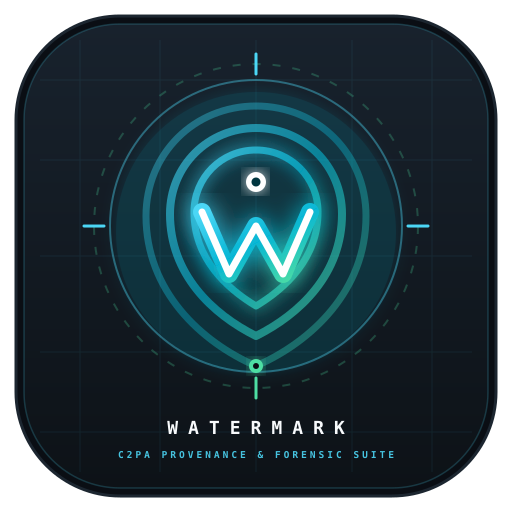
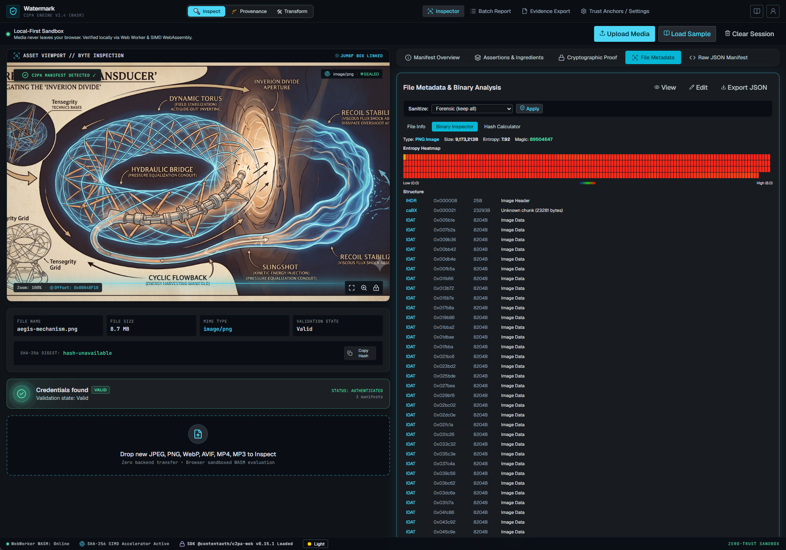
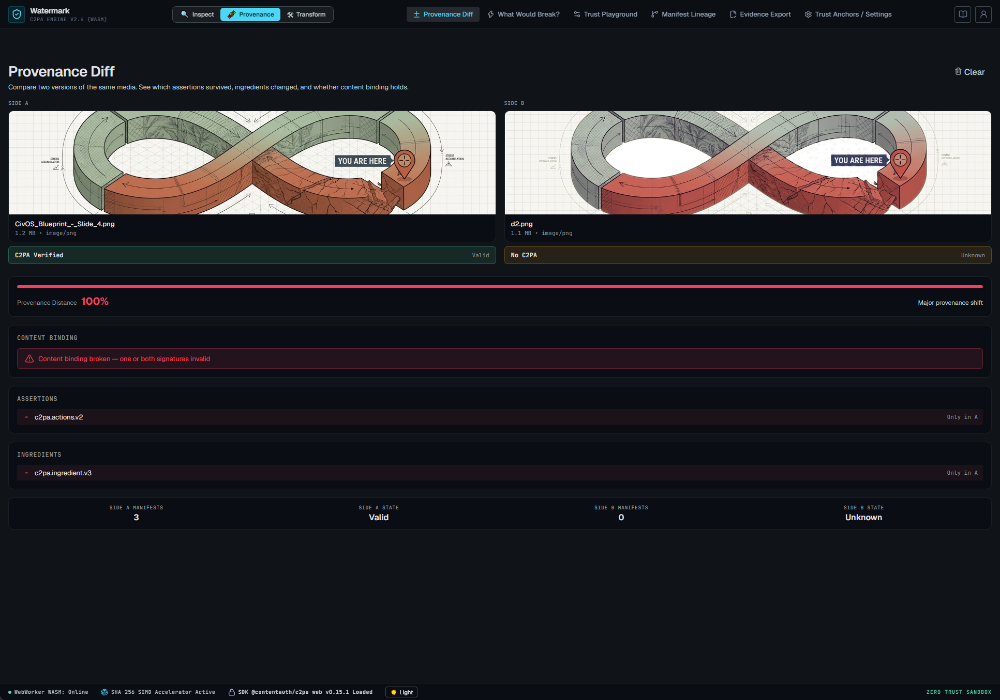
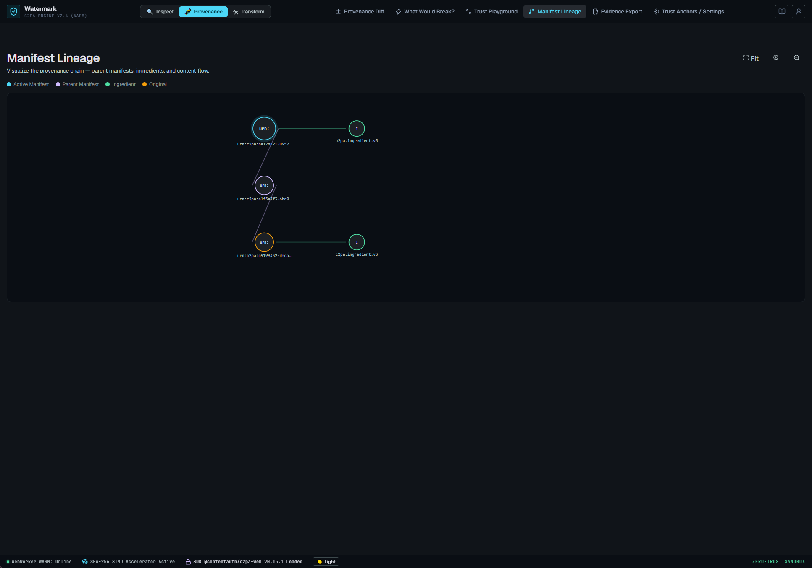
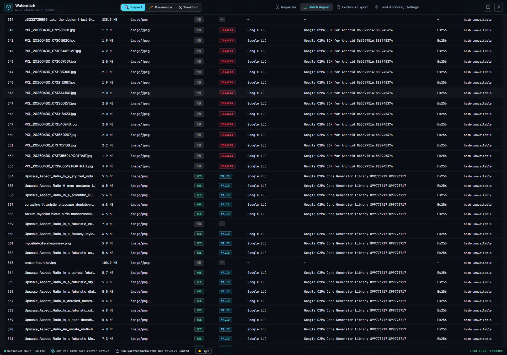
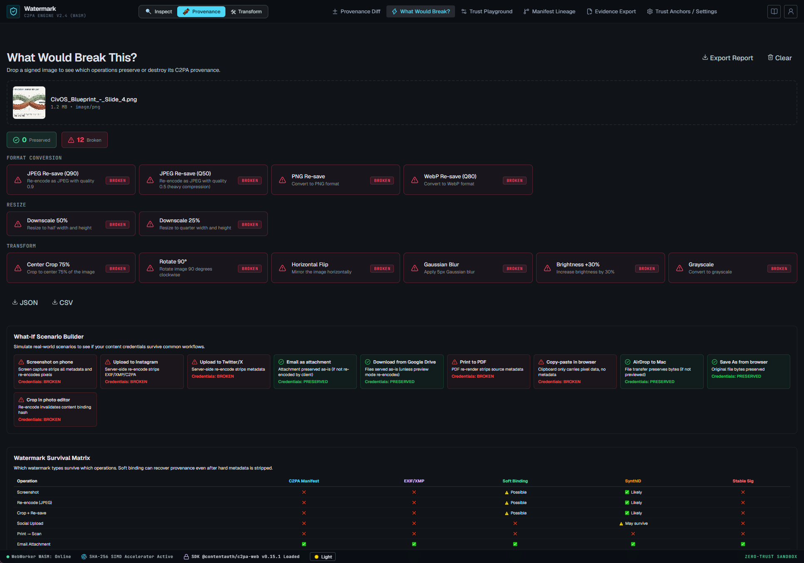

<p align="center">
  
</p>

<p align="center">
  <a href="https://kylosarc.github.io/watermark/docs/"></a>
  <a href="https://kylosarc.github.io/watermark/"></a>
  <a href="https://github.com/kylosarc/watermark"></a>
  <a href="http://localhost:42069"></a>
  <a href="https://github.com/kylosarc/watermark/actions/workflows/ci.yml"></a>
</p>

<p align="center">
  
  
  
  
</p>

---

# Watermark

**A local-first provenance and forensic workbench for C2PA Content Credentials, media, documents, and text.**

Watermark lets you inspect what a file claims about its origin and history, verify what can actually be cryptographically verified, examine metadata and content bindings, compare provenance across versions, and investigate AI-generation and watermark signals — entirely in your browser.

**Your files stay on your machine.**

> **A claim is not the same thing as a verification.**

Watermark is designed around that distinction. A C2PA manifest can contain assertions about an asset's origin, creation, modification, or processing history. Watermark helps you examine those assertions, validate the cryptographic relationships that can be validated, and see where the evidence ends.

## Why Watermark?

Digital provenance systems are becoming an increasingly important part of how digital content is identified, attributed, and trusted. But provenance is not a binary question of "authentic" or "fake."

A useful inspection tool needs to let people see:

* what a file contains;
* what a C2PA manifest claims;
* which signatures and content bindings validate;
* whether an issuer is trusted;
* what metadata exists outside the manifest;
* what provenance relationships exist between assets;
* what survives common transformations;
* and what **cannot** be established from the available evidence.

Watermark puts those questions into a single local-first workspace.

> There is, as yet, no law that requires that I submit to the tyranny of provenance.

Watermark treats provenance as evidence to examine, not authority to obey.


## Verification Boundaries

Watermark deliberately distinguishes **claims, cryptographic verification, and truth**.

A successful C2PA verification can establish that relevant cryptographic relationships are intact and, depending on the trust result, that the signer chains to a trusted issuer.

It does **not** independently establish that every factual statement in the manifest is true.

Likewise:

* A valid signature does not make every assertion truthful.
* A trusted issuer does not make every assertion universally correct.
* A missing C2PA manifest does not prove that content is human-made.
* The presence of an AI-related provenance assertion does not by itself establish every detail of how content was created.
* The absence of a detected watermark does not prove that no watermark exists.

Watermark is therefore an **evidence and inspection tool**, not a truth oracle.

The project rule is simple: **everything should be falsifiable**. If a result cannot be checked against a source, it is labeled as a claim or a heuristic, never as a verdict.


## Screenshots

### **Binary Inspector**

<p align="center">
  
</p>

### **Provenance Diff**

<p align="center">
  
</p>

### **Provenance Lineage**

<p align="center">
  
</p>

### **Media Batch Tool**

<p align="center">
  
</p>

### **What Would Break**

<p align="center">
  
</p>


## What Watermark Can Do

### 🔐 Verify Provenance

* Discover C2PA Content Credentials
* Validate manifest signatures and content bindings
* Display issuer and certificate information
* Distinguish **Trusted**, **Valid**, **Invalid**, and **Unknown**
* Calculate SHA-256 file digests
* Inspect hard and soft content bindings
* Examine complete manifest JSON

### 🔗 Carry Evidence Between Tools

* Inspect an object once, then open **What Would Break?**, **Trust Playground**, or **Edit with Provenance** without re-uploading it
* Auto-run simulations and policy checks on entry when a shared object is already loaded
* Turn auto-run off per browser in **Trust Anchors / Settings**; manual uploads always wait for an explicit run
* Check **Runtime Diagnostics** (secure context, hash path, active media, SDK version) when a device behaves differently
* Export a cross-file pattern summary from Batch: issuers, claim generators, signature algorithms, shared assertions, AI/watermark claims, and signing range

### 🔎 Investigate Provenance

* Explore manifests, assertions, and ingredients
* Examine manifest lineage
* Compare two provenance states with **Provenance Diff**
* Generate structured **Evidence Packs**
* Compare issuers, claim generators, signature algorithms, and shared assertions across a folder
* Review file metadata alongside C2PA provenance
* Inspect binary structure and entropy
* Examine what survives common transformations

### 💧 Investigate Watermarks & AI Signals

* Surface watermark-related C2PA assertions
* Surface SynthID-related claims when present
* Inspect C2PA soft-binding information
* Identify C2PA AI-generation source-type assertions
* Compare watermark/provenance survival across transformations
* Scan text for hidden Unicode with exact code points, positions, and selective cleanup
* Count word pairs and repeated 3–5 word phrases within sentence boundaries
* Show which provider watermarks can actually be verified, with cited sources

### 🧪 Test & Simulate

* Re-encode media
* Crop images
* Convert formats
* Test whether provenance survives transformations
* Explore common scenarios such as screenshots, email, and social-media processing
* Experiment with trust policies

### ✍️ Analyze Writing

* Choose a POV (first, second, third) or auto-detect it, then scan narration for sentences that leave it
* Count every word with per-1,000-word rates; filter common words or search the full list
* Surface nearby word echoes, repeated sentence openers, and sentence-length rhythm
* Flag crutch/filler words, filter words, hedges, intensifiers, emotion telling, body/reaction clichés, redundancies, and weasel words
* Match clichés against a built-in list and count simile/metaphor candidates without pretending to interpret them
* Suggest offline alternatives for repeated content words
* Estimate Flesch Reading Ease, Flesch–Kincaid, and Gunning Fog; count adverbs, nominalisations, dialogue share, said-bookisms, and adverb tags
* Export all writing findings in the complete TXT/CSV report

Writing findings are revision prompts, not verdicts. The lexicons are local and
source-visible; no draft is sent to a thesaurus or language service.

### 🛠️ Work With Your Files

* Edit selected metadata
* Sanitize metadata
* Compare hashes before and after changes
* Perform provenance-aware image editing
* Extract text from supported documents
* Analyze and transform text
* Export the full text analysis as JSON, or flattened summary, phrase, and NLP CSVs
* Export a complete flat-text or tidy-CSV report for the selected file or every file in the batch
* Produce self-contained trust reports

### 🔒 Local-First Privacy

Files are processed in the browser rather than uploaded to a remote analysis service.

Original files are never overwritten. Processing occurs in memory, with local persistence used for application state and audit information.

## What Watermark Does Not Do

Watermark does not attempt to produce a single universal authenticity score.

It does not claim that:

* a file without C2PA provenance is necessarily inauthentic;
* a file with C2PA provenance is necessarily truthful;
* a valid signature proves the factual accuracy of every assertion;
* an AI detector can reliably determine authorship from text alone;
* the absence of a detected watermark proves that no watermark exists;
* metadata alone establishes provenance.

Instead, Watermark exposes the available evidence and shows which relationships can actually be verified.

This distinction is fundamental to the project.


## Run locally

```bash
npm install
npm run dev
```

Vite serves the app at `http://localhost:42069`.

### Production server

For serving the built `dist/` folder (no dev server):

```bash
npm run build

# Option A: Python (simplest)
cd dist && python3 -m http.server 42069 --bind 0.0.0.0

# Option B: Node.js static server
node server.cjs
```

### Persistent server (tmux)

For a server that survives terminal disconnects:

```bash
tmux new-session -d -s watermark "cd dist && python3 -m http.server 42069 --bind 0.0.0.0"
```

To manage:
```bash
tmux ls                    # list sessions
tmux attach -t watermark   # view server logs
tmux kill-session -t watermark  # stop server
```

### Remote access (Tailscale)

If your machine is on a Tailscale network:

```bash
# Start server bound to all interfaces
tmux new-session -d -s watermark "cd dist && python3 -m http.server 42069 --bind 0.0.0.0"

# Access via Tailscale IP
# http://<tailscale-ip>:42069
```

## Commands

```bash
npm run build
npm run typecheck
npm test
```

Every push and pull request to `main` runs `.github/workflows/ci.yml`: install, typecheck, tests, and a production build.

## Architecture

```
src/
├── App.tsx              ~2400 lines — Main app, routing, header/footer
├── main.tsx             React entry + ErrorBoundary
├── styles.css           CSS variables, dark/light theme
├── lib/
│   ├── c2pa.ts          C2PA SDK wrapper (v0.15.1 Reader.fromBlob API)
│   ├── verification.ts  Manifest summarization, AI source types, soft binding
│   ├── evidence.ts      EvidenceStatus, Finding, Perspective domain model
│   ├── metadata.ts      EXIF extraction, binary analysis, entropy heatmap, sanitizer
│   ├── harper.ts        Grammar checker (WASM, lazy-loaded)
│   ├── winkNlp.ts       NLP analysis (sentiment, POS, entities)
│   ├── transform.ts     Text stripping, PII redaction, unsloping, homoglyphs
│   ├── textAnalysis.ts  Text metrics, style heuristics, NLP enrichment
│   ├── ngrams.ts        Word-pair and 3–6 word phrase counting
│   ├── textForensics.ts Hidden-Unicode scan and selective cleanup
│   ├── textExport.ts    Full JSON, complete TXT/CSV report, summary/phrase/NLP CSVs
│   ├── writingAnalysis.ts POV, tics, clichés, echoes, frequency, readability
│   ├── providers.ts     Cited provider status and cleanup-layer model
│   ├── extract.ts       Text extraction (PDF, PPTX, DOCX, jschardet)
│   ├── file.ts          Hashing (SHA-256, SHA-1, MD5), format detection
│   ├── persist.ts       localStorage + IndexedDB persistence
│   ├── currentFile.ts   Shared current-media store across tools
│   ├── preferences.ts   Tool auto-run defaults, stored locally
│   ├── batchPatterns.ts Cross-file issuer/generator/assertion patterns
│   ├── audit.ts         Session audit trail
│   └── types.ts         Shared TypeScript types
└── features/
    ├── inspector/       BinaryInspector, HashCalculator, MetadataTab, ManifestCard
    ├── provenance/      DiffView, LineageView, ProvenanceGraph, EvidencePanel
    ├── simulator/       SimulatorView (What Would Break? + Survival Matrix)
    ├── playground/      PlaygroundView (Trust Policy rules)
    ├── text/            TextView, WritingPanel, UnicodePanel, ProviderStatusPanel
    └── batch/           BatchView (multi-file verification + pattern summary)
```

## Important notes

**This software is under active development.** While we strive for accuracy, results may not always be as expected.

### Text processing limitations

- PDFs with letter-spacing may produce garbled output in grammar features
- Scientific notation, chemical formulas, and technical content may be incorrectly flagged
- Text extraction may lose formatting, embedded images, or complex layouts
- The unsloper is designed for prose and may not work on code or technical docs
- Hidden Unicode characters are not proof of AI; word processors and chat apps insert them too
- The style score is an experimental heuristic, not a watermark detector or authorship test
- Writing findings (POV shifts, echoes, clichés, tics, simile/metaphor candidates) are pattern heuristics, not editorial verdicts
- The offline synonym list is small and context-blind; it is not a thesaurus
- Dialogue quote detection does not parse attributions or speaker turns
- Claude and SynthID text watermarks cannot be verified locally by any public tool

### Video and media limitations

- Video files show a poster frame extracted at 10% duration
- Large video files may take longer to process
- Some media formats may not be fully supported by the C2PA SDK

### Your files are safe

**Original documents and media are never overwritten.** All processing happens in memory. Your source files remain completely untouched on disk.

### Security

Dependency audits run in CI, Dependabot checks npm and GitHub Actions weekly, and
the default path makes no network requests. See [`SECURITY.md`](SECURITY.md) for
reporting and scope.

## Verification boundaries

A trusted C2PA result means the SDK validated the manifest signature, content binding, and issuer trust policy. It does not prove that every statement in the manifest is true. A missing manifest does not establish that content is human-made or AI-generated.

## Roadmap

Near-term work, ordered by how much it strengthens the evidence:

- **Signed C2PA fixture corpus** — real signed manifests plus tampered, truncated, soft-bound, AI-source, and watermark-claim variants, used by tests instead of hand-built objects alone.
- **Browser smoke tests** — secure and insecure contexts, 320/390/1440 px layouts, shared-media flow, and auto-run defaults running against a real Chromium.
- **Accessibility pass** — keyboard navigation, focus order, contrast, and screen-reader labels across the inspector and tool views.
- **Bundle budget** — keep the C2PA WASM, wink model, and main bundle from growing silently; fail CI on unexplained size regressions.
- **Opt-in public-URL inspection** — explicit, labeled, public URLs only; never uploads, never permission-granting, never part of the default path.

Writing-focused follow-ups:

- **Tense consistency** — let a writer pick past/present and flag candidate shifts, excluding dialogue.
- **Dialogue attribution parser** — speaker turns, unattributed stretches, and tag density beyond the current word-level heuristics.
- **Show-vs-tell prompts** — sentence-level revision prompts for emotion labels, filter verbs, and summary narration, with the full context always visible.
- **Custom lexicons** — import/export a project-specific list of character names, world terms, crutches, and preferred spellings.
- **Draft comparison** — compare two drafts' frequencies, echoes, rhythm, and POV counts without merging their text.

## References

- [C2PA technical specification](https://spec.c2pa.org/specifications/specifications/2.4/specs/C2PA_Specification.html)
- [C2PA JavaScript SDK](https://github.com/contentauth/c2pa-js)
- [Supported C2PA media formats](https://opensource.contentauthenticity.org/docs/c2patool/docs/supported-formats)
- [SynthID overview](https://deepmind.google/technologies/synthid)
- [Haimaker — Claude watermark removal guide (layered cleanup)](https://haimaker.ai/blog/claude-watermark-removal-guide/)
- [Harper - Grammar checker](https://github.com/Automattic/harper)
- [wink-nlp - NLP toolkit](https://github.com/winkjs/wink-nlp)
- [exifr - EXIF reader](https://github.com/MikeKovarik/exifr)
- [piexifjs - EXIF writer](https://github.com/hMatoba/piexifjs)
- [picscrub - Metadata scrubber](https://github.com/asher-wood/picscrub)

## License

MIT. See `LICENSE`.
